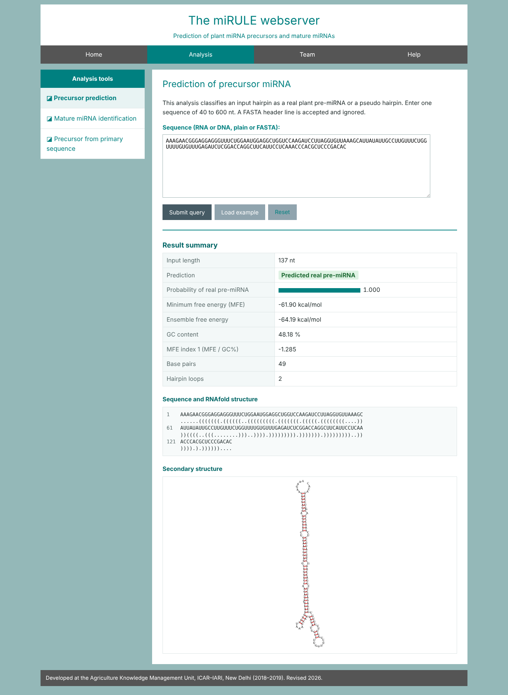
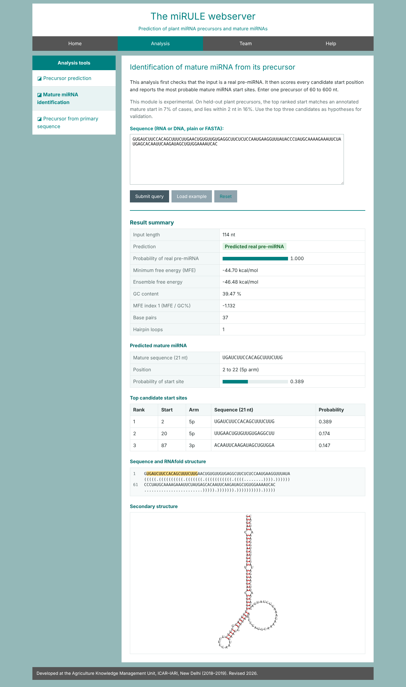
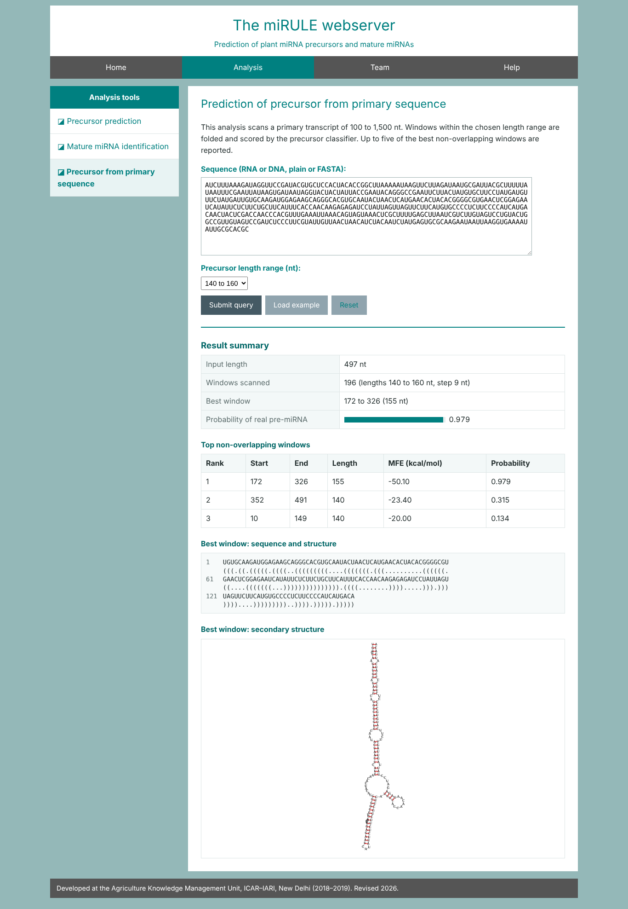
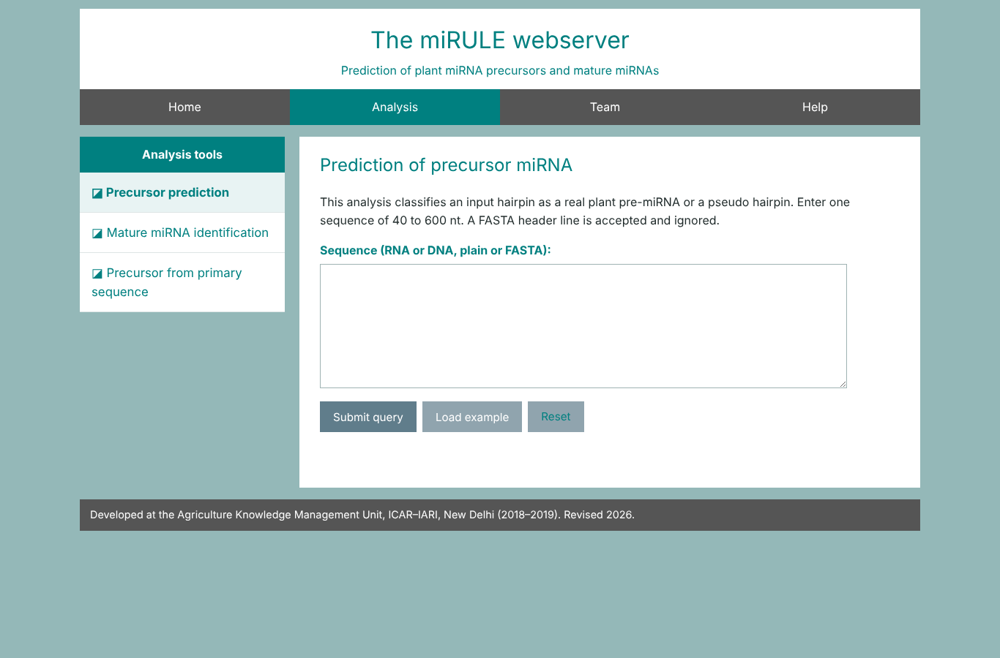
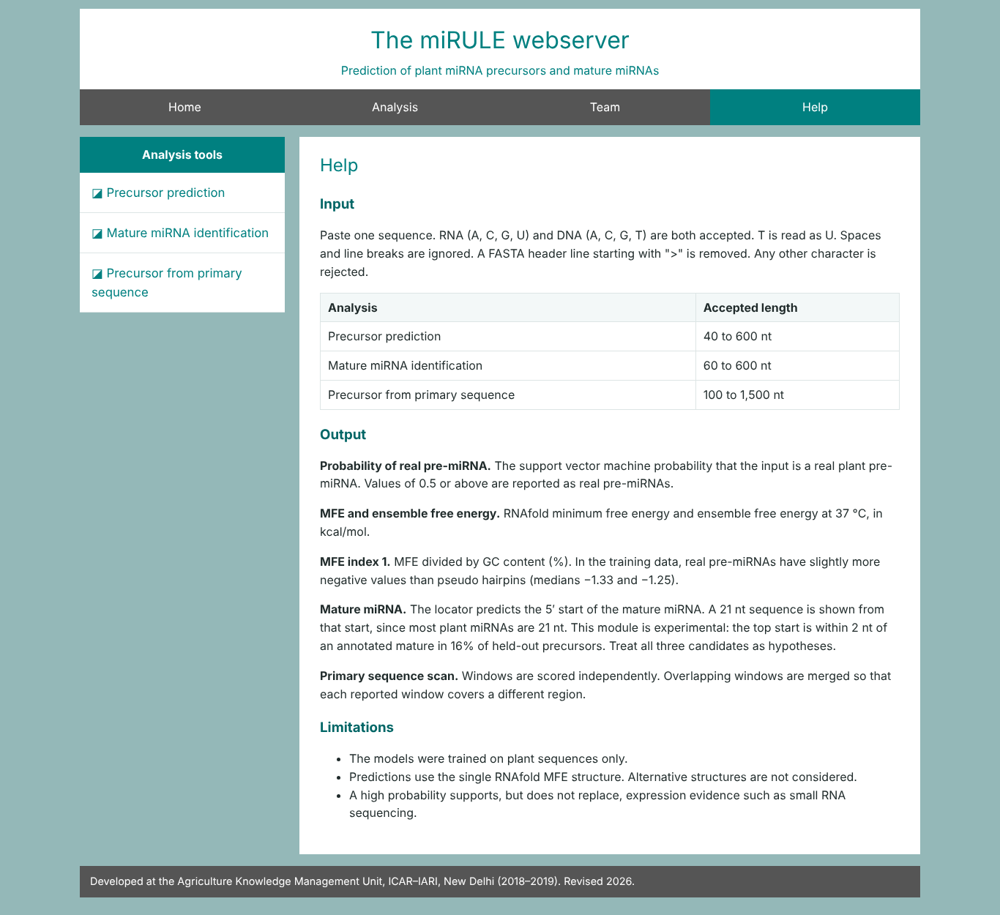
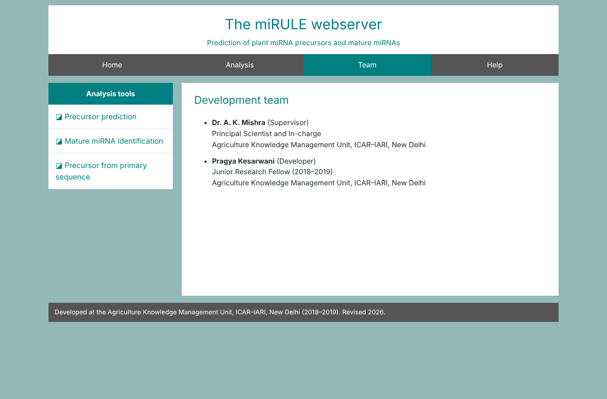

# miRULE: plant miRNA precursor and mature miRNA prediction


miRULE is a webserver that predicts plant microRNA precursors (pre-miRNAs) and their mature miRNAs from sequence alone. It has three analyses: precursor prediction, mature miRNA identification and precursor detection in a longer primary sequence. The front end is PHP on Apache. The back end is Python, with RNAfold from the ViennaRNA Package and scikit-learn models.

The webserver was first built in 2018–2019 at the Agriculture Knowledge Management Unit, ICAR–IARI, New Delhi. This repository is a revised version with a complete feature pipeline, retrained models, security fixes and a Docker set-up.

## Contents

- [Screenshots](#screenshots)
- [What it does](#what-it-does)
- [How it works](#how-it-works)
- [Features used by the precursor model](#features-used-by-the-precursor-model)
- [Training data](#training-data)
- [Performance](#performance)
- [Limitations](#limitations)
- [Changes from the 2019 version](#changes-from-the-2019-version)
- [Installation and usage](#installation-and-usage)
- [Repository layout](#repository-layout)
- [Credits](#credits)
- [References](#references)

## Screenshots

All screenshots show real output from the code in this repository, produced with the **Load example** inputs.

### Home page


### Precursor prediction

Input: a plant miR166 precursor (137 nt). The page reports the class, the probability, RNAfold energies, the dot-bracket structure and a structure drawing.



### Mature miRNA identification (experimental)

Input: a plant miR396 precursor (114 nt) that was not used to train the mature locator. The top candidate starts at position 2. The annotated miR396 starts at position 7, and the third candidate (position 87) lies 3 nt from the annotated 3p start (position 90). This example reflects the modest accuracy of this module (see [Performance](#performance)).



### Precursor from primary sequence

Input: a constructed 497 nt demo with the miR164 precursor at positions 171 to 327, placed between two shuffled 170 nt flanks. The best window (172 to 326) recovers the planted precursor.



<details>
<summary>Input form, Help and Team pages</summary>







</details>

## What it does

| Analysis | Input | Output |
|---|---|---|
| Precursor prediction | One hairpin, 40 to 600 nt | Real pre-miRNA or pseudo hairpin, probability, RNAfold structure and energies |
| Mature miRNA identification (experimental) | One precursor, 60 to 600 nt | Precursor check, then the three most probable mature start sites with a 21 nt mature sequence |
| Precursor from primary sequence | One transcript, 100 to 1,500 nt, plus a length range | Up to five non-overlapping windows ranked by probability |

## How it works

```
sequence ──► input validation (PHP and Python)
         ──► RNAfold (ViennaRNA 2.7.2): MFE structure, MFE, ensemble free energy
         ──► 39 features ──► SVM (RBF kernel) ──► probability of real pre-miRNA
         ──► candidate starts: nucleotide, pairing and loop distance ──► gradient boosting ──► mature start site
```

The web front end is PHP on Apache. It calls the Python back end (`mirule/predict.py`) without a shell and receives JSON.

## Features used by the precursor model

All 39 features are computed from the sequence and its RNAfold MFE structure. Each definition was checked against the original training table. On 3,505 real precursors whose sequences could be recovered, every feature matched the stored value in at least 99.9% of rows.

| Group | Feature (column name) | Definition |
|---|---|---|
| Thermodynamic | `minimum free energy` | RNAfold MFE (kcal/mol) |
| | `free energy per length (dG)` | MFE / length |
| | `efe` | Ensemble free energy from the partition function (kcal/mol) |
| | `mfe-efe` | (MFE − EFE) / length |
| | `MFE index 1` | MFE / GC content (%) |
| | `MFE index 4` | MFE / number of base pairs |
| Structural | `no. of base pairs` | Base pairs in the MFE structure |
| | `no of bp per length` | Base pairs / length |
| | `hairpin numbers` | Number of hairpin loops |
| | `maximum size` | Largest hairpin loop (nt) |
| | `average size` | Mean hairpin loop size (nt) |
| Sequence | `length` | Sequence length (nt) |
| | `gc content`, `au content`, `gu content` | (G+C)%, (A+U)%, (G+U)% |
| | `A %`, `C %`, `G %`, `U%` | Single nucleotide composition (%) |
| | `GC per length` | GC content (%) / length |
| | `g/c`, `U/A`, `A/C` | Nucleotide count ratios |
| | 16 dinucleotides (`AA frequency` … `UC`) | Non-overlapping count / length |

MFE index 1 is related to the minimal folding free energy index of Zhang et al. (2006), without its length normalization. Column names are kept exactly as in the 2019 table.

### Features from the 2019 table that are not used

The original table had 87 features. The remaining 48 could not be recomputed to match the stored values, so the deployed model does not use them. A model that sees different feature values at prediction time than in training gives unreliable output.

| Features | Count | Reason |
|---|---|---|
| Structure entropy, enthalpy and melting temperature, raw and normalized | 6 | Produced by an external tool that is not in the project; ViennaRNA estimates correlate only moderately with the stored values (r = 0.68 to 0.78) |
| Stem number, average and longest stem, terminal loop, MFE index 2, stems per length, AU, GC and GU per stem | 9 | No consistent definition reproduces the stored values (best match about 50% of rows) |
| Triplet structure–sequence features (Xue et al., 2005) | 32 | Stored values use denominators unrelated to sequence length; the original definition could not be recovered |
| `GU per length` | 1 | Identical to `GC per length` in the stored table, so it adds no information |

## Training data

| | Count |
|---|---|
| Rows in the 2019 training table | 7,070 |
| Rows after removing duplicates and conflicting labels | 5,680 |
| Real plant pre-miRNAs | 3,064 |
| Pseudo hairpins | 2,616 |

About 19% of the original rows were exact duplicates. In a random split they fall into both training and test folds, which inflates accuracy. They were removed before every evaluation below.

## Performance

### Precursor classifier (deployed model)

SVM with RBF kernel on standardized features (scikit-learn 1.9.1). Cross validation is stratified 5 fold on the 5,680 unique rows. The independent test set is the 71 sequence set from the 2019 project (54 real, 17 pseudo). None of its rows occur in the training data.

| Evaluation | Accuracy | Sensitivity | Specificity | MCC | AUC |
|---|---|---|---|---|---|
| 5 fold CV, 39 features (deployed) | 98.0% | 97.6% | 98.5% | 0.960 | 0.997 |
| 5 fold CV, all 87 stored features (reference only) | 98.6% | 98.4% | 98.9% | 0.972 | 0.998 |
| 5 fold CV, sequence length only (baseline) | 72.6% | 81.7% | 61.9% | 0.447 | 0.807 |
| Independent test set, 39 features | 88.7% | 88.9% | 88.2% | 0.721 | 0.938 |

The 95% confidence interval for the independent accuracy is 79.3% to 94.2% (Wilson). The test set is small, so treat this figure with care.

### Original 2019 results (Weka, all 87 features)

From the 2019 project notes, for comparison.

| Algorithm | Cross validation accuracy | Independent test set accuracy (71 sequences) |
|---|---|---|
| SVM | 98.55% | 73.23% |
| MLP | 98.20% | 70.42% |
| Simple Logistic | 98.82% | 73.23% |
| Random Tree | 98.64% | 78.87% |
| Naive Bayes | 98.95% | 77.46% |

The 2019 cross validation was run on the table that still contained the duplicate rows. The gap between cross validation and the independent set was large. Standardizing the features before the SVM and removing duplicates narrowed it.

### Mature miRNA locator

Built from scratch, because the 2019 training rows encoded the wrong region. Training uses the raw plant precursor and mature sequence files in `data/`. Precursors are kept when they contain one or two known mature sites (5p and 3p arms). Those with more sites were mostly repetitive sequences where short matures matched by chance. That leaves 17,653 precursors.

Each candidate start is described by the nucleotide and pairing state of 4 nt upstream plus 24 nt, and by its distances to the sequence ends and the terminal loop. A gradient boosting classifier (scikit-learn `HistGradientBoostingClassifier`) scores every start. It was trained on 2,000 precursors (42,121 windows) and tested on 600 precursors that were not used in training.

| Held-out evaluation (600 precursors) | Result |
|---|---|
| Top ranked start equals an annotated start | 7.0% |
| Top ranked start within 2 nt of an annotated start | 15.8% |
| Random start (baseline, exact) | 0.5% |

The locator is about 13 times better than chance but is not accurate enough to name a mature miRNA on its own. The web page labels it as experimental and lists three candidates. An RBF SVM on the window codes plus two relative position features reached 5.3% exact and 10.2% within 2 nt on the same split.

## Limitations

- The models were trained on plant sequences only.
- Real and pseudo sequences in the training data differ in length (medians 129 and 265 nt) and in hairpin loop number (medians 1 and 4). Only 53 pseudo hairpins have a single hairpin loop. On those, cross validation specificity is 81%, against 99% for multi-loop pseudo hairpins. Expect more false positives on single-hairpin decoys.
- Predictions use the single RNAfold MFE structure.
- The mature locator predicts the 5′ start. The 21 nt length shown is a default, since most plant miRNAs are 21 nt (Axtell, 2013).
- The primary scan scores windows independently and does not model DCL1 processing.

## Changes from the 2019 version

| Area | 2019 version | This version |
|---|---|---|
| Security | The sequence was inserted into a `shell_exec` command string, which allowed command injection | `proc_open` with an argument array (no shell), server-side validation in PHP and Python, length limits, HTML escaping of all output |
| Concurrency | Every request wrote to the same CSV files, so simultaneous users could overwrite each other's input | Data passes in memory as JSON; nothing is written to shared files |
| Features | 7 of 87 features were computed; the other 80 were set to zero | All 39 model features are computed and verified against the training table |
| Mature model | Training rows encoded the wrong region (precursor and mature lists were out of order), and the page crashed | Training set rebuilt from the raw sequences with label cleaning; the page works end to end and reports held-out accuracy |
| Primary scan | Crashed (decimal list index) | Works; reports up to five non-overlapping windows |
| Models | Pickles tied to scikit-learn 0.20 and Python 3.6 | Retrained with pinned current versions; training scripts included |
| Pages | Typos, missing Help page, hardcoded server paths | Text corrected, Help page added, layout works on small screens |

## Installation and usage

### Run the webserver

With Docker:

```bash
docker build -t mirule .
docker run -p 7860:7860 mirule
# open http://localhost:7860
```

Without Docker (Python 3.13 and PHP 8 needed):

```bash
pip install -r requirements.txt
MIRULE_ROOT=$PWD MIRULE_PYTHON=$(which python) php -S localhost:8000 -t web
# open http://localhost:8000
```

The PHP built-in server is for local testing only.

### Use the back end from the command line

```bash
python -m mirule.predict precursor GUGACAGAAGAGAGUGAGCAC...
python -m mirule.predict mature <precursor sequence>
python -m mirule.predict primary <primary sequence> 140 160
```

Each command prints one JSON object with the prediction, the RNAfold structure and the energies.

### Verify the features

```bash
python tests/verify_features.py
```

This recomputes every model feature for 200 recovered training sequences and compares it with the stored value.

### Retrain the models

```bash
python training/train_precursor.py   # under a minute
python training/train_mature.py      # about 3 minutes
```

Each script writes its model to `models/` and its metrics to `training/*_report.json`.

### Example inputs

The **Load example** buttons fill in real plant precursors from conserved families: miR166 for precursor prediction and miR396 for mature identification. The miR396 precursor was held out from training of the mature locator. The primary scan example is a constructed demo. It places the miR164 precursor (positions 171 to 327) between two shuffled 170 nt flanks.

## Repository layout

```
mirule/            Python back end
  features.py      feature calculation and window encoding
  predict.py       command line entry point used by the web pages
web/               PHP front end (copied to the Apache web root)
  inc/             layout, safe back end caller, result rendering, examples
  assets/          stylesheet
models/            trained models (joblib)
training/          training scripts and their JSON reports
tests/             feature verification against the training table
data/              training table, independent test set, plant precursor and mature sequences
docs/screenshots/  screenshots used in this README
Dockerfile         container image (Apache, PHP and Python; port 7860)
```

## Credits

Developed by [Pragya Kesarwani](https://www.linkedin.com/in/pragya-kesarwani-87242a3b/) under the supervision of Dr. A. K. Mishra, Agriculture Knowledge Management Unit, ICAR–IARI, New Delhi.

## References

- Axtell M. J. (2013). Classification and comparison of small RNAs from plants. *Annual Review of Plant Biology* 64, 137–159.
- Lorenz R. et al. (2011). ViennaRNA Package 2.0. *Algorithms for Molecular Biology* 6, 26.
- Pedregosa F. et al. (2011). Scikit-learn: machine learning in Python. *Journal of Machine Learning Research* 12, 2825–2830.
- Xue C. et al. (2005). Classification of real and pseudo microRNA precursors using local structure-sequence features and support vector machine. *BMC Bioinformatics* 6, 310.
- Zhang B. H. et al. (2006). Evidence that miRNAs are different from other RNAs. *Cellular and Molecular Life Sciences* 63, 246–254.
